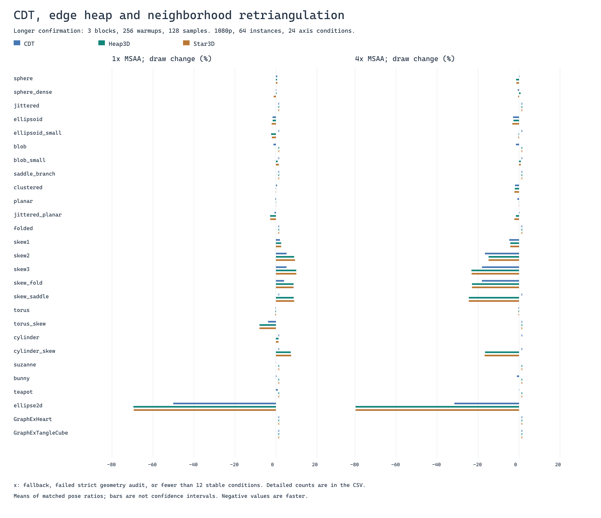
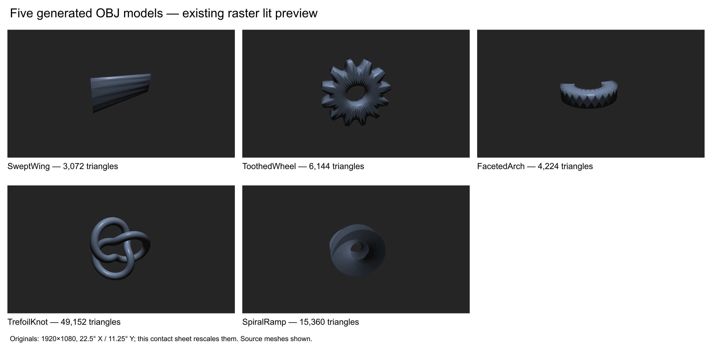

# Triangle connectivity, raster work and GPU performance

Study record, 15 October 2026. All performance conclusions below refer to **1920×1080 on an RTX 4050 Laptop GPU**, using the existing GraphEx raster lit shader. There is no ray tracing, triangle-count reduction, vertex-count reduction or LOD in a paired comparison.

## What we learned

**Connectivity can matter greatly when the source contains repairable long, thin triangles, especially at 4× MSAA. The source triangulation and projected workload matter more than the name or visual complexity of the object.** Our planar ellipse fan improves indexed-draw time by about 80% at 4×; deliberately inefficient wing/wheel/arch sources improve by 40–70%; skewed curved surfaces improve by 11–37%. Suzanne, Bunny and Teapot show no confirmed material improvement under the tested strict-preservation methods.

Reducing total edge length is a useful way to find bad connectivity, but is not a sufficient performance objective. Some skewed 3D meshes become **slower at 1× despite 29–62% shorter world edges**, then substantially faster at 4×. Helper diagnostics can increase while draw time decreases. We should optimize and measure the projected raster workload at the intended footprint/MSAA, with geometry and cache constraints, rather than assume a fixed percentage of edge reduction guarantees a speedup.

The largest new-model gains repair deliberately introduced source defects. They are evidence that connectivity matters, not estimates of typical production-asset gains. Balanced controls greatly reduce the remaining headroom.

## Measurement and validity

### Timing scopes and protocol

- D3D12, shader model 6.7, NVIDIA driver 610.62, Release MSVC 19.44/Falcor 8. Clocks were **not locked**. The shared Falcor timer correction is saved in [falcor-gpu-timer.patch](falcor-gpu-timer.patch) and applied in the measured local builds.
- Main workloads: 64 instances, depth enabled, culling disabled, fixed material/light/background, 1× and 4× MSAA. Each model has 8 rotations around each axis separately: 24 conditions, including three copies of the identity, hence 22 unique static poses. The latest reports retain all 24 requested conditions; they are not 24 independent shapes or independent statistical replicates.
- Vertex positions, storage/order, used vertex count and final triangle count stay fixed across methods. Normals come from the fixed source. Meshoptimizer uses the same cache/overdraw policy (threshold 1.05); vertex-fetch reordering is disabled in this experiment. The resulting index sequences still differ, so cache behavior and early-depth ordering can interact with connectivity.
- Candidates, metrics and pipelines are prepared first, followed by one second of GPU priming. Method and view order are randomized with seed 20261010. A queue of eight query slots retires results after fences; it does not drain after every draw.
- Screening: 2 blocks, 64 warmup draws and 32 measured samples per case. Longer confirmation: 3 blocks, 256 warmups and 128 samples. All samples are retained, including outliers.
- **Draw** timestamps enclose the indexed draw only. **Pass** encloses clear, draw and MSAA resolve. Query readback, diagnostic shaders, counter queries, UI and presentation are outside these scopes. These are GPU region times, **not whole-application or presented-frame times**.
- D3D12 pipeline statistics measure a separate uninstrumented draw after timing: input primitives, VS and PS invocations. Another diagnostic draw estimates quad/helper work. The timed lit shader has no diagnostic atomics or helper counting.
- Every raw sample is checked for finite positive durations, correct IDs/counts, enclosing pass ≥ draw, and agreement with recomputed mean, median, standard deviation, min and max. Hardware input primitive counts are checked against triangles × instances.

An independently uploaded identical **SourceControl** is randomized alongside candidates. A pose passes the practical drift gate when its Source/SourceControl mean deviation is ≤2% and its worst block deviation is ≤3%. A model-level recommendation requires at least 12 valid stable conditions and a mean draw gain exceeding 3%. These are practical calibration rules, **not p-values or confidence intervals**. The reports average matched per-pose percentage changes; aggregate-time-ratio columns are also retained. A smaller accepted subset can favor some angles, so eligible counts must accompany the result.

The unlocked laptop GPU and workload-dependent clocks remain limitations even when SourceControl passes. One-second telemetry cannot attribute frequency changes to individual draws. Repeated randomized controls reduce temporal drift; they do not isolate DVFS from a workload's response.

### Geometry eligibility

Audits check duplicate/degenerate triangles, nonmanifold edges, winding, source boundary, used vertices, connected components and Euler characteristic. Both candidate→source and source→candidate distances sample vertices, unique-edge midpoints and triangle centroids. **Strict** means sampled error ≤0.1% of the source bounding-box diagonal in both directions, with a small numerical comparison margin. Loose/Wide experiments allow 0.5%/2%; patch backends have a 2% audit ceiling and a separate strict-equivalence flag.

These finite samples do not certify continuous Hausdorff distance, absence of self-intersections, arbitrary attribute preservation, or every vertex-link condition. The reference is the input polygonal surface, not the analytic procedural shape. An algorithm that returns SourceFallback has failed to produce a new triangulation; its timing is not evidence of a connectivity gain.

The reverse audit rejects candidates that the optimizer's current one-way local guards accept, including some Suzanne/Bunny/Teapot and blob results. Rejected results are retained in the summaries and excluded from strict conclusions. The wing's plain world heap also fails marginally (0.10088%); its plane-penalized result passes.

Earlier investigations exposed a reused timestamp resolve buffer left in CopySource state. Pre-fix timing claims in historical `analysis/*.md` are superseded. The results below use the corrected timer and validated queued protocol. Positive times and pass ≥ draw alone were insufficient to detect that original defect.

## Measured results

All changes are percentages relative to matched Source poses: **negative means less time/work**. Tables use static Heap3D unless another method is named. World edge length sums unique geometric edges once per mesh; projected Euclidean edge length sums their pixel-space projections over all instances, including occluded edges. Helper values are diagnostic proxies, not literal wasted ALU instructions in the lit shader. Times below are changes in the average measured GPU region; matched absolute draw/pass means in milliseconds are saved in [confirmed_measurements.csv](confirmed_measurements.csv), alongside the changes and eligible counts. Different poses/workloads have different baselines; the mean of per-pose percentage changes need not equal the ratio of those absolute means.

### Original model matrix

The broad study screened 27 named inputs and 23 general backend/heuristic variants, plus applicable grid and topology experiments. It validated **92,736 cases and 6,147,072 raw samples** across screening, core confirmation, special fixtures and selected-method confirmation. Headline values below come from the longer core confirmation, except the skew torus marked special.

| Source / method | MSAA | Eligible / 24 | World edges | Projected edges | Draw | Pass | Helpers | PS invocations |
|---|---:|---:|---:|---:|---:|---:|---:|---:|
| Planar ellipse fan / Heap3D | 1× | 23 | −93.13% | −92.95% | −69.56% | −63.81% | −88.55% | +0.00% |
| Planar ellipse fan / Heap3D | 4× | 21 | −93.13% | −92.93% | −79.80% | −53.36% | −94.16% | −65.84% |
| Skew torus / Heap3D (special) | 1× | 21 | −50.71% | −52.83% | −7.48% | −7.35% | −0.59% | +0.51% |
| Skew torus / Heap3D (special) | 4× | 18 | −50.71% | −52.90% | −36.68% | −32.20% | −20.82% | −15.81% |
| Skew cylinder / Heap3D | 1× | 24 | −28.77% | −33.81% | +7.25% | +7.17% | see summary | see summary |
| Skew cylinder / Heap3D | 4× | 24 | −28.77% | −33.81% | −16.59% | −14.87% | +1.99% | −0.29% |
| Skew grid 2 / Heap3D | 4× | 24 | −50.47% | −48.69% | −14.87% | −8.70% | +11.94% | +7.42% |
| Skew grid 3 / Heap3D | 4× | 23 | −61.63% | −58.59% | −23.23% | −13.64% | +7.52% | +9.97% |
| Ellipsoid / view-dependent HeapQuadView (selected) | 4× | 22 | +1.59% | −12.64% | −6.00% | −4.33% | see summary | −5.56% |
| GraphEx Tangle Cube / HeapPlane (selected) | 4× | 16 | −7.40% | −7.03% | −3.46% | −3.13% | see summary | see summary |

Full method/model coverage, error, CPU cost, changes and excluded-condition counts are in [summary.csv](../analysis/gpu/all_models/summary.csv); [geometry_recommendations.csv](../analysis/gpu/all_models/geometry_recommendations.csv) records the selected outcomes. Small differences among the best observed methods do not establish algorithm superiority.

CDT also helps when the chart contains poor connectivity. On the planar ellipse, CDT improves draw time by 50.11% at 1× and 31.56% at 4×, versus 69.56%/79.80% for the world heap. On skew grid 2 at 4×, CDT improves draw time by 16.64%, slightly more than the heap despite a smaller 41.55% world-edge reduction. Its measured backend construction is about 8.58 ms versus 101.39 ms for the heap, excluding shared source/patch preparation. These measurements argue for keeping CDT as a practical baseline.

Suzanne, Bunny and Teapot give approximately −0.02%, −1.04% and +0.12% draw changes with CDT at 4×, with only about 0.03%, 0.58% and 0.62% world-edge reductions. They offer little demonstrated strict connectivity headroom. Regular sphere/dense sphere, regular torus and already regular planar grids likewise show no confirmed material mean gain in this study. Many flips can still exchange almost equal diagonals: changed triangle count alone does not establish an improvement.

### Five deliberately improvable 3D sources

The additional study validated **16,800 cases and 1,643,520 raw samples** across screening, confirmation, controls and a one-object workload. All five admit more than 20% world-edge reduction with a valid static method.

| Model | Vertices / triangles | Source defect | Static method |
|---|---:|---|---|
| Swept Wing | 1,538 / 3,072 | Dense fans across planar panels on a thin swept/twisted faceted body | HeapPlane |
| Toothed Wheel | 3,072 / 6,144 | Dense panel fans on a concave toothed body with a hole | Heap3D |
| Faceted Arch | 2,114 / 4,224 | Dense front/back fans on a U-shaped beam | Heap3D |
| Trefoil Knot | 24,576 / 49,152 | Integer helical UV shear on a smooth self-occluding tube | Heap3D |
| Spiral Ramp | 7,913 / 15,360 | Sheared lattice on an open nonplanar helicoid | Heap3D |

Static-method results, 64 instances; projected/helper/PS columns are 4×:

| Model | World edges | Projected edges | Draw 1× | Draw 4× | Pass 4× | Helpers 4× | PS 4× | Eligible 4× / 24 |
|---|---:|---:|---:|---:|---:|---:|---:|---:|
| Swept Wing | −82.19% | −82.37% | −59.84% | −70.48% | −57.78% | −59.32% | −31.90% | 23 |
| Toothed Wheel | −57.57% | −55.55% | −27.55% | −40.68% | −31.10% | −45.50% | −28.80% | 24 |
| Faceted Arch | −52.07% | −54.33% | −13.43% | −39.90% | −27.71% | −41.61% | −26.97% | 24 |
| Trefoil Knot | −27.43% | −25.47% | +3.86% | −10.66% | −9.68% | −1.62% | −2.23% | 23 |
| Spiral Ramp | −45.84% | −45.74% | +1.38% | −27.31% | −22.34% | −10.23% | −7.87% | 20 |

View-dependent projected-L1 optimization gives best observed 4× draw changes of −42.31% wheel, −43.20% arch and −11.81% knot. These are modest incremental improvements over static preprocessing, with additional preparation and view dependence; they do not justify CPU rebuilding every frame.

Balanced/short-diagonal controls reduce the static heap's remaining 4× gains to **3.93% wing, 4.18% wheel, 8.37% arch, 0.88% knot and 3.98% ramp**. Each control keeps exactly the same vertex list and triangle count as its candidate source. Panel controls retain the same planar surface; knot control removes UV shear; ramp control only chooses shorter cell diagonals and is not a globally optimal triangulation. Controls use normals from their own fixed source, so comparing absolute source/control times across those runs would also change attributes. The within-run comparisons remain controlled.

With one larger object, static 4× draw/pass changes are −31.61%/−13.38% wheel, −23.44%/−6.30% arch, −15.16%/−7.38% knot and −32.52%/−14.24% ramp. Knot/ramp also improve 1× draw by 12.99%/15.80%, reversing their 64-instance regressions. Instance count changes primitive load, footprint and lighting directions together; this is workload sensitivity, not an isolated scale experiment. The one-object wing has only 11 stable conditions at 1× and 6 at 4×, below the predefined threshold; its means remain exploratory.

See [five-candidate summary](../analysis/gpu/five_candidates/summary.csv), [complete interpretation](../analysis/gpu/five_candidates/report.txt), and [model descriptions/hashes](../analysis/gpu/five_candidates/models.json). The best-observed-method CSV differs deliberately from the static-method table above.

The matching strict-pose absolute means at 4× were:

| Model / method | Source draw → candidate draw | Source pass → candidate pass |
|---|---:|---:|
| Planar ellipse / Heap3D | 0.11261 → 0.02238 ms | 0.18242 → 0.08373 ms |
| Swept Wing / HeapPlane | 0.34279 → 0.09902 ms | 0.41694 → 0.17272 ms |
| Toothed Wheel / Heap3D | 0.31882 → 0.18927 ms | 0.43352 → 0.29889 ms |
| Faceted Arch / Heap3D | 0.18860 → 0.11284 ms | 0.27211 → 0.19617 ms |
| Trefoil Knot / Heap3D | 0.94474 → 0.84370 ms | 1.04253 → 0.94127 ms |
| Spiral Ramp / Heap3D | 0.41922 → 0.30271 ms | 0.51841 → 0.40060 ms |

These average absolute times use the same accepted poses as their percentage comparisons. Ratios of averages and averages of pose ratios differ. They are short repeated GPU regions on this device, not complete frame latency.

## Why projected shape and coverage matter

1. **Long thin triangles create expensive projected boundaries and small-width work.** Their screen-space area can be unchanged while their axis-aligned bounding boxes, edge traversal and packet utilization change substantially. At 1×, the planar ellipse has unchanged PS invocation count yet much lower draw time. On the wing at 1×, PS invocations rise 13.63% and VS invocations rise 22% while draw falls 59.84%. These are strong clues that counting shader invocations alone misses relevant raster work; they do not identify a particular critical hardware unit.
2. **Pixel-frequency MSAA shading is per primitive with covered samples.** Two adjacent triangles can both invoke the pixel shader for one pixel when they own different sample subsets. Changing internal boundaries can therefore change invocation count without changing the outer silhouette. The 4× ellipse/wheel/arch results directly measure fewer PS invocations. The API's rasterization rules support this mechanism; they do not imply every internal edge incurs an equal cost. [Microsoft rasterization rules](https://learn.microsoft.com/en-gb/windows/win32/direct3d11/d3d10-graphics-programming-guide-rasterizer-stage-rules).
3. **Helpers are only one part of the work.** The diagnostic shader estimates quad waste under its own instrumentation. A lower helper proxy does not measure the lit shader's stall time or executed helper ALU, and PS queries are not unique useful-pixel counts. The skew grids become faster at 4× despite more helpers and more PS invocations. Traversal, MSAA coverage/depth, cache/order, scheduling and frequency response remain possible contributors. [D3D12 pipeline-statistics definitions](https://learn.microsoft.com/en-us/windows/win32/api/d3d12/ns-d3d12-d3d12_query_data_pipeline_statistics).
4. **Curvature limits legal repairs.** Coplanar regions permit large connectivity changes with no surface deformation; curved patches can replace chords with a different piecewise-planar surface. Strict error and crease guards leave fewer alternatives. An asymmetric shape can still have good source triangles, as Suzanne illustrates. The planar ellipse is a poor fan with enormous legal headroom; Suzanne's tested valid alternatives barely change its edge lengths.
5. **Visibility and the cost balance change with pose and size.** Projected lengths include occluded edges, whereas the timed draw includes depth behavior and real material/light work. Tiny triangles in an instance grid and large triangles on a single object stress different paths. A draw speedup is diluted in the enclosing pass by clear/resolve, and further diluted in a complete application by other work.

Neither summed area nor perimeter is a complete predictor. With a fixed surface, area often barely changes; useful shape features include minimum projected altitude, subpixel fraction, sliver fraction, projected AABB area, edge orientation/L1 length, tile/quad coverage, and depth/visibility. Cache/order and hardware VS/PS work should be measured alongside them.

In the broad core CDT/Heap3D confirmation, model/method means with ≥12 valid stable conditions show a descriptive Spearman association of **+0.808 projected-edge change vs draw change at 4×**, but **−0.279 at 1×**. Leaving whole geometries out, a projected-edge-only ridge fit gives R²=0.657 at 4× and −0.510 at 1×; adding bbox/helper features gives 0.696 at 4×. Features are correlated and the sample is small, GPU-specific and selected by eligibility. These checks do not establish causality, a universal predictor or a 20%-edge-reduction performance threshold. Details: [associations.txt](../analysis/gpu/all_models/associations.txt).

## Which methods earn their place?

| Method | What it does here | Assessment |
|---|---|---|
| Source Faces | Retains triangle faces; locally projected ear clipping for polygon faces | Essential reference. Source is often already adequate. |
| CDT | Constrained Delaunay in nearly planar surface patches | Keep. Useful quality baseline and often inexpensive; chart angle quality is not GPU-time optimality. |
| CDT + Flip | Local edge improvements after CDT, projected cost by default; world scoring optional | Keep as a reference. Often close to CDT; expose fallback. |
| Heap3D / HeapPlane | Max-heap diagonal shortening with topology/crease/convexity/source guards; Plane subtracts four times quad plane residual | Strongest simple static experiment on poor connectivity. Plane helps the wing retain a valid surface. Final reverse audit remains necessary. |
| Projected heaps | Projected Euclidean/L1 objectives over fixed, current, stale or warm-start views | Worth research for view/footprint awareness; incremental gains and preparation cost must be measured. |
| Greedy Point Set | Feasible-edge sorting and constrained graph completion in a projected patch; optional world weights | Experimental comparison, no unique confirmed general GPU advantage. |
| LMT | Local witnesses, greedy completion and flips | Experimental; not a proof of global minimum-weight triangulation. Frequent fallback and little unique GPU value here. |
| Greedy Projection (GP) | Custom PCL-inspired neighborhood/projected graph code | Experimental, not actual PCL. Real PCL greedy projection reconstructs a surface from points and normals; this study starts with connected meshes. |
| Star3D | Heap, bounded convex-star DP/reinsertion, then heap | Broader connectivity search with fixed counts, but no meaningful confirmed extra GPU gain for its CPU cost. |

In the original all-method screen, GP fell back on 19/27 inputs, Greedy on 17/27 and LMT/LMT3D on 21/27. Valid stable strict comparisons with at least 12 conditions were available on only 7, 8, 3 and 3 inputs respectively at 4×. They have not earned production-default status on these meshes. This is an assessment of our implementations/workload, not a general rejection of reconstruction or minimum-weight research. [PCL greedy projection](https://pointclouds.org/documentation/tutorials/greedy_projection.html), [CGAL surface processing](https://doc.cgal.org/latest/Polygon_mesh_processing/index.html), [Blender triangulation choices](https://docs.blender.org/manual/en/5.0/modeling/modifiers/generate/triangulate.html).

Star3D preserves the disk boundary and reinserts the same center after retriangulation, with valence 4–12 and at most three sweeps. It is a bounded cavity-like transaction, not unrestricted topology surgery. On cylinder/ellipsoid it shortened edges only about another 0.017%/0.011% and changed GPU draw by about −0.27%/−0.58% relative to the heap, within noise, while backend CPU cost rose to roughly 3415/212 ms versus 532/26.6 ms. Keep it research-only.

Whole-grid alignment is valuable when source parameterization is known: on skew torus at 4× it improves draw/pass by 37.06%/32.15%, matching the heap's 36.68%/32.20% with about 25.69 ms versus 309.07 ms backend CPU. This is a fixture-specific global repair, not a general OBJ method.

True topology surgery did not help. The torus→two-tori experiment preserved counts and total Euler characteristic but changed the sampled surface by about 9.4% of bounds, lengthened edges by 30.8% and regressed draw by 1.35%/12.87% at 1×/4×. For a closed orientable triangulated manifold, `3F=2E` and `χ=V−E+F=2C−2Σg`: fixing V, F and component count fixes total genus. The rasterizer consumes the resulting triangles, not a genus label. This experiment does not support a useful topology-only acceleration claim.

## Candidate selection and next research

Prioritize **bad source connectivity with legal alternatives**: fans, sheared UV lattices, long slivers, large planar/faceted regions, or coherent grids whose parameterization can be repaired. Check projected footprint and MSAA before selecting an objective. Do not select solely by asymmetry, shape name, changed-triangle count, genus or world-edge reduction. Preserve Source + meshoptimizer when strict alternatives have little headroom or fail the audit.

The most promising next experiment is a **feature-preserving offline projected raster-cost objective** at the target 1080p footprint and MSAA. Keep vertex/triangle counts fixed. Compare world length against projected L1, triangle/tile or quad coverage, subpixel altitude and sample-boundary costs. Include a cache/order penalty or evaluate candidates under the same meshoptimizer policy. Start with cheap conservative estimates and validate their ranking against GPU draw/pass measurements; do not claim a hardware cost model from perimeter alone.

Use a small precomputed view bank only if its measured incremental GPU savings justify preprocessing, storage and switching. Current substantial-mesh per-view setup is often hundreds of milliseconds, so per-frame CPU rebuilding is not supported. For any dynamic option, measure `break-even frames = added preparation time / per-frame GPU saving`, with compatible units and any upload/switch cost included. Average length over broad orthographic directions can resemble world length; view averaging alone adds no pixel-grid or MSAA term.

Improve local flip acceptance with symmetric source/candidate samples before committing a transaction; retain the final reverse audit. Continue using the same area guard that rejects roundoff-degenerate new triangles. Larger neighborhoods should be revisited only with an objective that predicts measured benefit; the current star experiment spends substantially more CPU for little gain.

To identify the exact limiting GPU stage behind the 1×/4× sign reversal, obtain vendor raster/depth/occupancy/stall counters. Nsight tools were available, but vendor-counter access failed with `ERR_NVGPUCTRPERM`; API pipeline statistics still worked. Until that is resolved, raster traversal/coverage is a supported explanation, not a proven identification of the critical hardware unit. [NVIDIA counter-permission documentation](https://developer.nvidia.com/ERR_NVGPUCTRPERM).

## Why the live profiler fluctuates more

The live render callback includes clear, draw, resolve/blit and requested synchronous readbacks/captures; UI and presentation are separately profiled. Frame pacing, tiny scopes, compilation/pipeline creation on changes, laptop clocks, and the profiler's moving average all affect what appears in the UI. Enabling diagnostic readback adds blocking work. The benchmark instead prepares first, sustains repeated queued work, separates diagnostics, randomizes methods and rejects unstable controls. Lower variation there is expected; it does not make the measurements noise-free or turn draw time into complete frame time.

Use Draw to study connectivity's direct raster cost and Pass to quantify the enclosing workload benefit. Use a separate continuous application/present measurement for user-visible frame pacing. Keep raw distributions and control drift; do not hide fluctuations by reporting only a smoothed UI value.

## Reproduction, assets and provenance

The [README](../README.md) gives build, VS2022, capture and benchmark commands. The model dropdown exposes all 27 original inputs, the five new candidates and their five controls. The 22 `Study:` procedural entries call the same benchmark fixture generator; seven adjustable generators remain separate. The fifteen OBJ presets use the existing importer, including offline GraphEx Heart/Tangle Cube exports. No SDF importer or new lighting implementation was added.

Run the [matrix driver](../analysis/gpu/all_models/run_matrix.ps1) for screen/confirm/special stages and [selected driver](../analysis/gpu/all_models/run_selected.ps1) for the frozen extra-method plan. The [five-candidate driver](../analysis/gpu/five_candidates/run.ps1) has screen/confirm/control/large stages. Shared validators are [connectivity/analyze.py](../analysis/gpu/connectivity/analyze.py) and [topology/analyze.py](../analysis/gpu/topology/analyze.py); full aggregation requires the generated local raw files.

Historical binaries are identified in run metadata and [broad-study manifest](../analysis/gpu/all_models/study_manifest.json), with exact source digests. Broad runs used the recorded dirty source based on `4aa97ac`, subsequently committed in `012f2f9`/`deff9f1`; the five-candidate measurements used `6d3a922`, followed by GUI-only preset registration in `2a3cb66`. The [five-candidate manifest](../analysis/gpu/five_candidates/manifest.json) retains those identities and file hashes. New catalog/documentation commits do not retroactively identify the measured executable.

Committed evidence includes compact summaries, recommendations, validation records, figures, manifests and reusable scripts. Generated per-run CSV/raw/raster files, telemetry, logs, captured frames, exploratory preflights, binaries and copied-source harnesses stay local under `analysis/`; they are not needed to build the app. Raw-file hashes in historical manifests allow checking those retained local runs. The study can be rerun with current source, but exact timings need not match across builds, devices or power conditions.
